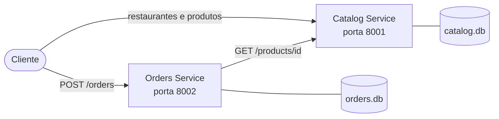

<div align="center">


[](https://github.com/gui69961/feifood-api/actions/workflows/ci.yml)


**Versão web do [Feifood](https://github.com/gui69961/Feifood): uma API REST de pedidos de comida, dividida em dois microsserviços que se comunicam por HTTP.**

<a href="#-arquitetura">Arquitetura</a> ·
<a href="#-endpoints">Endpoints</a> ·
<a href="#%EF%B8%8F-como-executar">Como executar</a> ·
<a href="#-testes">Testes</a> ·
<a href="#-ci">CI</a>

</div>

---

## 📖 Sobre

O **Feifood** nasceu como um software de pedidos de comida em C. Este projeto reimagina a ideia como um **back-end moderno**:
uma API REST em **Python (FastAPI)**, dividida em **dois microsserviços independentes**, cada um com o seu próprio banco de dados,
com **testes automatizados** e **integração contínua (CI)** no GitHub Actions.

O foco é praticar o que se espera de um engenheiro de software no dia a dia: **APIs, microsserviços, bancos de dados,
testes, versionamento, containers e pipeline de CI**.

## 🏗️ Arquitetura



| Serviço | Responsabilidade | Banco |
|---|---|---|
| **Catalog Service** | Cadastro de restaurantes e produtos | SQLite (`catalog.db`) |
| **Orders Service** | Criação e acompanhamento de pedidos | SQLite (`orders.db`) |

**Decisões de projeto**

- **Um banco por serviço:** os serviços não compartilham dados; o Orders Service pergunta ao Catalog Service pela API.
- **Preço congelado no pedido:** ao comprar, o nome e o preço do produto são copiados para o pedido. Se o catálogo mudar depois, o pedido antigo não muda.
- **Falhas tratadas:** se o catálogo estiver fora do ar, o Orders Service responde `503` em vez de quebrar. Produto inexistente responde `404`.
- **Máquina de estados:** um pedido só avança em ordem (`CRIADO → PREPARANDO → A_CAMINHO → ENTREGUE`) e só pode ser cancelado antes de sair para entrega.
- **Regras isoladas:** as regras de negócio ficam em `rules.py`, sem banco nem HTTP, o que as deixa fáceis de testar.
- **Injeção de dependência:** o banco e o cliente do catálogo entram como dependências do FastAPI, e por isso os testes os trocam por versões falsas.

## 🔌 Endpoints

### Catalog Service · `http://localhost:8001`

| Método | Rota | Descrição |
|---|---|---|
| `GET` | `/health` | Verifica se o serviço está no ar |
| `POST` | `/restaurants` | Cria um restaurante (`409` se o nome já existir) |
| `GET` | `/restaurants` | Lista os restaurantes |
| `POST` | `/restaurants/{id}/products` | Cria um produto no restaurante |
| `GET` | `/restaurants/{id}/products` | Lista os produtos do restaurante |
| `GET` | `/products/{id}` | Busca um produto (usado pelo Orders Service) |

### Orders Service · `http://localhost:8002`

| Método | Rota | Descrição |
|---|---|---|
| `GET` | `/health` | Verifica se o serviço está no ar |
| `POST` | `/orders` | Cria um pedido (consulta o catálogo e calcula o total) |
| `GET` | `/orders` | Lista pedidos (filtro opcional: `?status=PREPARANDO`) |
| `GET` | `/orders/{id}` | Busca um pedido |
| `PATCH` | `/orders/{id}/status` | Avança o status (`409` se a transição for inválida) |

> 📚 Cada serviço tem documentação interativa gerada automaticamente em **`/docs`** (Swagger UI):
> `http://localhost:8001/docs` e `http://localhost:8002/docs`.

## ▶️ Como executar

### Opção 1: Docker (recomendado)

```bash
git clone https://github.com/gui69961/feifood-api.git
cd feifood-api
docker compose up --build
```

### Opção 2: Python direto

Precisa do **Python 3.12+**. Abra dois terminais:

```bash
# Terminal 1: Catalog Service
cd catalog-service
pip install -r requirements.txt
uvicorn app.main:app --port 8001
```

```bash
# Terminal 2: Orders Service
cd orders-service
pip install -r requirements.txt
CATALOG_URL=http://localhost:8001 uvicorn app.main:app --port 8002
```

> No Windows (PowerShell), defina a variável antes: `$env:CATALOG_URL="http://localhost:8001"`

### Exemplo de uso

```bash
# 1) Criar um restaurante e dois produtos
curl -X POST localhost:8001/restaurants -H "Content-Type: application/json" \
  -d '{"name": "Burger Dev", "category": "Lanches"}'

curl -X POST localhost:8001/restaurants/1/products -H "Content-Type: application/json" \
  -d '{"name": "X-Burguer", "price": 22.5}'

curl -X POST localhost:8001/restaurants/1/products -H "Content-Type: application/json" \
  -d '{"name": "Refrigerante", "price": 7}'

# 2) Fazer um pedido: o Orders Service consulta o catálogo e calcula o total (52.0)
curl -X POST localhost:8002/orders -H "Content-Type: application/json" \
  -d '{"customer": "Guilherme", "items": [{"product_id": 1, "quantity": 2}, {"product_id": 2, "quantity": 1}]}'

# 3) Avançar o status do pedido
curl -X PATCH localhost:8002/orders/1/status -H "Content-Type: application/json" \
  -d '{"status": "PREPARANDO"}'
```

> No Windows, no lugar do `curl`, use a interface **`/docs`** de cada serviço, que é mais fácil.

## 🧪 Testes

Os testes usam **pytest** e rodam sem precisar subir nenhum serviço: o banco é um SQLite em memória e o catálogo é trocado por uma versão falsa.

```bash
cd catalog-service        # ou orders-service
pip install -r requirements-dev.txt
pytest --cov=app --cov-report=term-missing
```

| Serviço | Testes | Cobertura |
|---|---|---|
| Catalog Service | 13 | ~93% |
| Orders Service | 34 | ~95% |

**O que é testado**

- **Testes de API:** criação, listagem, validações (`422`), conflitos (`409`) e itens não encontrados (`404`)
- **Regras de negócio (unitários):** transições de status válidas e inválidas, cálculo do total
- **Comunicação entre serviços:** o cliente do catálogo é testado com respostas simuladas (`200`, `404`, `500` e falha de conexão)
- **Falhas:** catálogo fora do ar resulta em `503`

## ⚙️ CI

A cada `push` e `pull request`, o **GitHub Actions** ([`ci.yml`](.github/workflows/ci.yml)):

1. Roda os testes de **cada serviço em paralelo** (matriz), com Python 3.12
2. Falha se a **cobertura ficar abaixo de 85%**
3. Faz o **build das imagens Docker** para garantir que os containers continuam funcionando

## 📁 Estrutura

```text
feifood-api/
├── .github/workflows/ci.yml     # Pipeline de integração contínua
├── docker-compose.yml           # Sobe os dois serviços juntos
├── catalog-service/
│   ├── app/                     # database, models, schemas, main
│   ├── tests/
│   ├── Dockerfile
│   └── requirements.txt
└── orders-service/
    ├── app/                     # database, models, schemas, rules, catalog_client, main
    ├── tests/
    ├── Dockerfile
    └── requirements.txt
```

## 🧰 Tecnologias

| Área | Tecnologia |
|---|---|
| Linguagem | Python 3.12 |
| API | FastAPI, Pydantic, Uvicorn |
| Banco de dados | SQLAlchemy 2 + SQLite |
| Comunicação entre serviços | HTTP com httpx |
| Testes | pytest, pytest-cov |
| Containers | Docker e Docker Compose |
| CI | GitHub Actions |

## 🚀 Próximos passos

- [ ] Trocar o SQLite por PostgreSQL
- [ ] Autenticação de usuários com JWT
- [ ] Mensageria entre serviços (ex.: fila para avisar o restaurante)
- [ ] Deploy na nuvem (AWS)
- [ ] Migrações de banco com Alembic

---

## 👨‍💻 Autor

**Guilherme P** · [GitHub](https://github.com/gui69961) · [LinkedIn](https://www.linkedin.com/in/guilherme-pro%C3%A7a-6bb883387/) · [E-mail](mailto:proencaguilherme582@gmail.com)

<div align="center">


</div>
